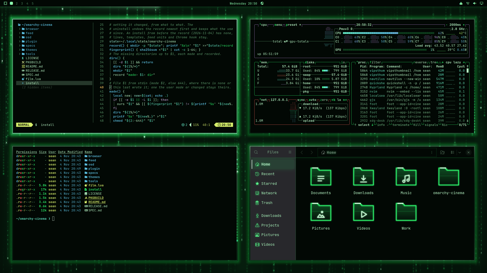

# The Matrix

The code, and the code is this very shader, or what the agents on this machine are writing once the user turns that on. It rains down the black screen in mirrored glyphs, each stream led by a white-hot head carrying the newest characters and leaving a fading phosphor tail. The rain stands at three distances, nearer columns larger, brighter and faster: the far rain out of focus, soft dots whose letters are lost in the air, and the mid rain, both behind the windows, so the glass shows them and the windows shade them; the near rain at the windows' own depth, falling round them, so it never shows through their glass and no window shades it. The rain parts round the windows: drops flare where they strike a window's top edge, and streams run down its sides, brightest beside the focused window. The gaps between windows glow faintly green. The windows stand in the rain, lit from above with it.

An [Omarchy](https://omarchy.org) theme from [Omarchy Cinema](https://github.com/seankd3/omarchy-cinema). On its
own it is a whole Omarchy theme with its film as the wallpaper. With the
Omarchy Cinema engine installed, the film comes alive: it is drawn around your
windows in the same frame as them, windows turn to glass with their text kept
solid, and Files, its folders and the dictation popup take its look.

    omarchy theme install https://github.com/seankd3/omarchy-the-matrix-theme

[Try it in the browser](https://seankd3.github.io/omarchy-cinema/play/?film=https://raw.githubusercontent.com/seankd3/omarchy-the-matrix-theme/HEAD/) before you install it.

## Make your own

Press *Use this template* to start a film from this one. Change
`colors.toml`, write `backdrop.frag` against [the contract](https://seankd3.github.io/omarchy-cinema/play/contract.html),
watch it in the [playground](https://seankd3.github.io/omarchy-cinema/play/),
name your repo `omarchy-<name>-theme`, and give it the topic
`omarchy-cinema` to list it in the gallery.

This repo is built from `themes/the-matrix` of [omarchy-cinema](https://github.com/seankd3/omarchy-cinema) by
`tools/theme-repo`; changes go there.

## Credits

A fan homage. The film and its marks belong to their owners; this theme is
not affiliated with or endorsed by them, and ships no film imagery: the
wallpaper is this theme's own `backdrop.frag`, drawn. MIT licence (LICENSE).
